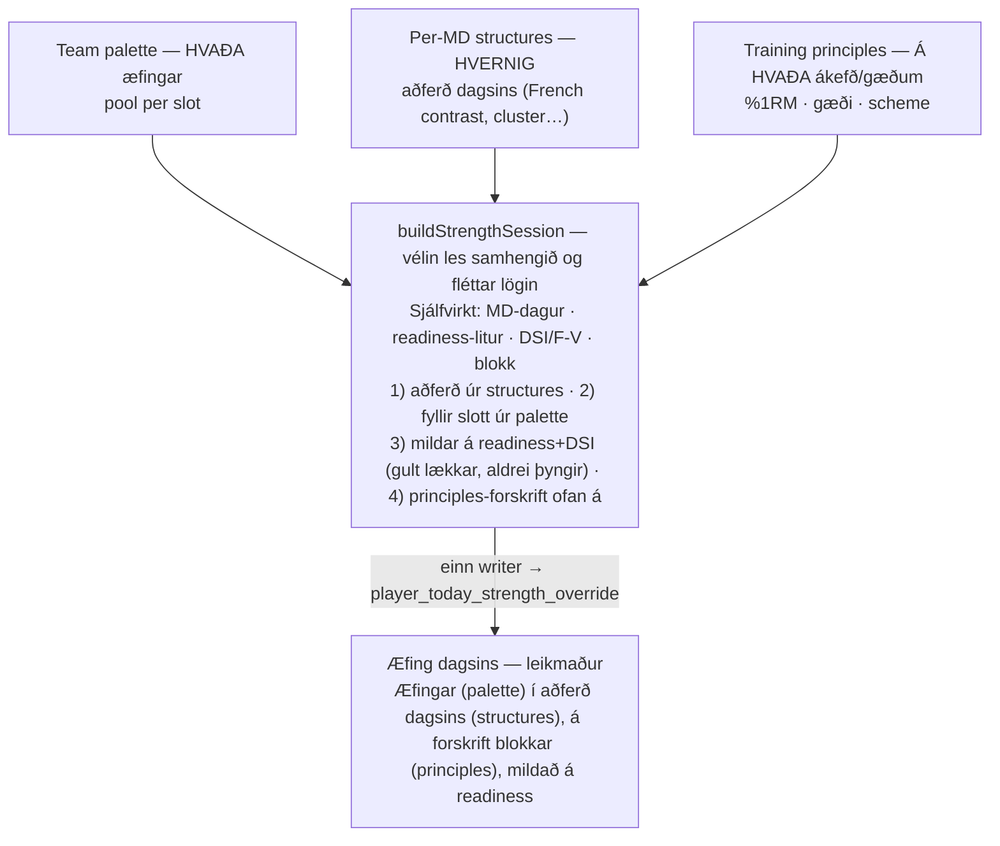
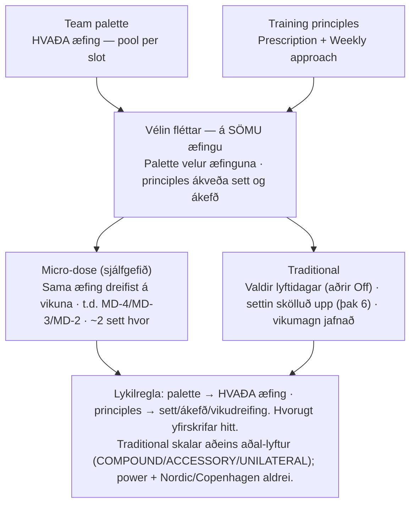
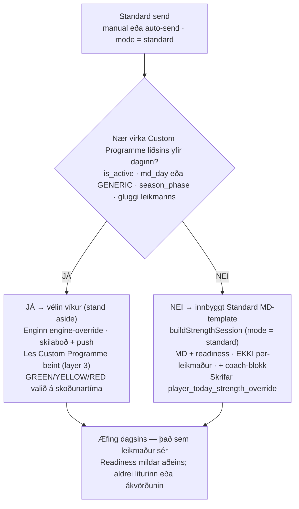
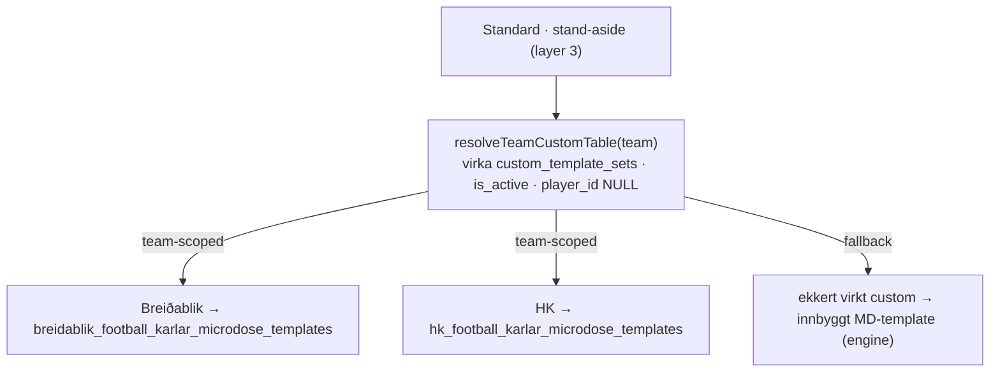

# Strength delivery — how the layers combine

Coach-facing explanation of how a player's **Æfing dagsins** (Daily session) is built and
delivered. Diagram labels are in Icelandic (coach-facing language); the prose is English.

Canonical reference for the precedence + writers: [`session-delivery-model.md`](session-delivery-model.md).
These diagrams are the intuition layer on top of it.

---

## 1. Individualised — three independent layers → one session

You set three layers, each in its own place, and the engine (`buildStrengthSession`) weaves
them into every player's session. They answer different questions and never overwrite each other.

---

## 2. Training principles × Team palette — what each changes

The team palette fixes **which** exercise fills each slot. Training principles decide **how many
sets** land on that exercise and **at what intensity** — including the **Weekly approach**
(micro-dose vs traditional). Changing a principle never changes the palette.

> **Evidence:** micro-dose vs traditional maintain strength when the **weekly volume is equated**
> — not merely when there are fewer days (Cuthbert 2021). That's why the traditional lift day
> scales its main-lift sets up to carry the dropped days' volume (capped at 6).

---

## 3. Standard mode — how the team's session is delivered

In **Standard** mode the coach can deliver the team's authored **Custom Programme** instead of the
engine's per-player build. When the active Custom Programme covers today, the send *stands aside*
and lets the player's own Today resolution serve it (readiness-reactive at view time); otherwise
the engine builds the built-in Standard MD template and writes the override.

> **Individualised vs Standard:** Individualised always builds per-player and writes the override
> (no stand-aside). The stand-aside path is Standard-only, and its readiness variant is picked on the
> **player's** side at view time, whereas the engine/override path locks readiness at send time.

---

## 4. Which table does Standard read from?

The stand-aside path reads the **team's own active Custom Programme table** — resolved
team-scoped by `resolveTeamCustomTable` from the team's `is_active` `custom_template_sets` row
(`player_id IS NULL`). Each team has its own dynamically-named table.

- The table name comes from the active set's `table_name` (the builder derives it from the bare
  club name: `slugify(club)_sport_{karlar|konur}_microdose_templates`).
- It is **always** read `.eq("team_id", …)` — a team never sees another team's table
  (team-scoped reads + the `workout_templates` RLS and microdose-view fixes guarantee this).
- `microdose_templates` (the shared default table) is **not** the per-team custom table; a team with
  no custom programme simply falls back to the engine's built-in MD template.

### Covered vs not covered (the one caveat)

- **Covered** (the team's active table has a row for today's `md_day`/`GENERIC` in the week's
  `season_phase`, within the player's window) → Standard delivers from that team's own table.
- **Not covered** (no active custom table, or no matching row) → Standard does **not** use a custom
  table; the engine builds the built-in Standard MD template and writes the override.
